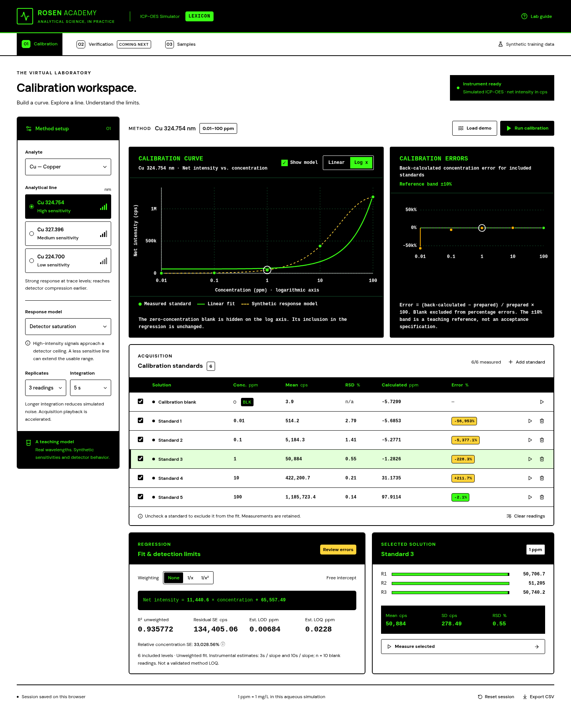

# Rosen Academy · ICP-OES Calibration Lab

An interactive educational instrument for exploring ICP-OES calibration. The entire interface is in English. Measurements and calculations run in the browser. The app can run locally, as a standalone file, or through Streamlit; it needs no instrument connection or external API credentials.



## Streamlit: persistent browser link

Live app: [Rosen Academy ICP-OES simulator](https://rosen-academy-3v6duxmcsbzvmerc3s52mk.streamlit.app/).

The **LEXICON** visual theme uses black text on white panels and bright green/white on black instrument displays.

The Streamlit entrypoint is **`streamlit_app.py`**. The existing English React laboratory is embedded unchanged, including its calibration model, CSV downloads, and browser-local session storage.

For Streamlit Community Cloud:

1. Sign in at [share.streamlit.io](https://share.streamlit.io/) and connect the GitHub account that can access this repository.
2. Create an app from repository **`spectroOES/rosen-academy`**, branch **`streamlit-calibration`**, entrypoint **`streamlit_app.py`**.
3. Select Python **3.12** in advanced settings, then deploy. `requirements.txt` installs the pinned Streamlit runtime. No secrets are required.
4. Streamlit provides the app's permanent URL after deployment. Repository access/privacy and app sharing are configured in the account's Streamlit settings.

This setup is deploy-ready; a local server or a successful test is not evidence that a Community Cloud app has been deployed. The first connection and deployment require access to the owner's Streamlit account.

### Updating the same link

The hosting server does not need Node.js: a deliberate, verified deployment bundle is committed in `streamlit_assets/`. After frontend changes, the developer runs:

```sh
npm run build:streamlit
```

Commit both source changes and `streamlit_assets/`, then push to the deployed branch. Community Cloud pulls the update. Open sessions check for a changed release every two seconds and refresh only when necessary; normal polling does not interrupt measurements. Community Cloud may take additional time to process a GitHub update or restart the app. After the update is processed, reload the existing app URL if needed. If an old version remains, the app owner can use **Manage app → Reboot app**. Keep the same app and URL; no new deployment needs to be created for an ordinary update.

### Streamlit development locally

```sh
python3 -m venv .venv
.venv/bin/python -m pip install -r requirements.txt
.venv/bin/python -m streamlit run streamlit_app.py
```

When Node/npm and the frontend dependencies are installed, saving a frontend source file triggers a new build on the next update check. Completed calibration readings survive the iframe refresh through browser-local storage. A failed update keeps the previous working simulator and retries after another source change. On a Python-only host, always commit a fresh deployment bundle.

The two-second watcher is outside the simulator iframe; it does not reset an active acquisition. Browser storage is specific to the app's domain: a session from a downloaded HTML file is separate from one on the public Streamlit URL.

## Run

Requires Node.js 22.12+ (tested with Node 24) and npm.

```sh
npm ci
npm run dev
```

Vite uses port 5173 by default. Open the address printed by the command in an environment that provides browser access to that port. To create and serve a production build:

```sh
npm run build
npm run preview
```

## Open without installing anything

Generate a self-contained simulator:

```sh
npm run build:standalone
```

Download `dist/rosen-academy.html` and open it directly in Chrome, Edge, or Firefox. It includes the application, styles, and fonts, and works without a server or Internet connection. Keep the file at the same location to retain its browser-local session; if the browser restricts local-file storage, CSV export remains available.

## First experiment

1. Click **Load demo** to acquire example measurements immediately, or **Run calibration** to watch sequential acquisition.
2. Compare **None**, **1/x**, and **1/x²** weighting without regenerating measurements. Inspect back-calculated concentration errors as well as R².
3. Exclude the 100 ppm standard with its checkbox and compare the fit. Measurements are retained.
4. Select a less sensitive analytical line and acquire a new calibration. Changing the line, response model, or integration time clears readings to avoid mixing incompatible measurements.
5. Use **Log x** to inspect the concentration range. The zero-concentration blank is hidden on this axis, but its regression inclusion remains unchanged.
6. Acquire **10 blank readings** to estimate instrumental LOD and LOQ. Export the session using **Export CSV**.

## Included

- Cu, Cd, Pb, Fe, and Zn, each with three selectable analytical lines.
- Editable standards from **0.01 to 100 ppm**, plus a zero-concentration calibration blank. Here ppm denotes mg/L in the simulated aqueous solutions.
- Linear response, detector compression/saturation, and smoothly curved response.
- 3, 5, or 10 repeat measurements; 1, 5, or 10 s integration with accelerated acquisition playback.
- Standard means, sample SD, RSD, free-intercept weighted linear regression, back-calculated concentrations, and error plots.
- Optional display of the underlying synthetic response curve, distinct from the fitted straight line.
- Browser-local session persistence and CSV export containing raw replicate data and calculation metadata.
- Locally bundled fonts: no remote font or analytics requests.

## Scientific model and limitations

**All measurements and response coefficients are synthetic.** The wavelength identifiers correspond to analytical lines, but sensitivity rankings, noise, compression, and curvature coefficients are teaching choices, not specifications for a particular instrument. Only the selected line is acquired in this prototype; it does not simulate simultaneous multi-line acquisition or a scanned spectrum.

With concentration `C`, sensitivity `b`, ceiling `S`, and negative curvature coefficient `q`, expected background-corrected intensity is:

- Linear: `b C`.
- Saturation: `S (1 − exp(−b C / S))`.
- Curvature: `b C (1 + q C)` within the supported concentration range.

The nonlinear modes generate nonlinear instrument response; the calibration remains a **linear regression**, deliberately exposing bias when a straight line is applied over an unsuitable range. There is no polynomial/nonlinear fitting in this version.

Replicates use seeded Gaussian noise combining electronic, photon/background, and proportional contributions, scaled by `1 / sqrt(integration time)`. Net blank signals may be negative. Blank RSD is labelled **n/a**, because percentages around zero are not informative.

Regression uses each included standard's mean as one observation, with a free intercept. Weights are 1, `1/x`, or `1/x²`. For inverse weights, zero concentration is replaced with the lowest positive included concentration **for the weight calculation only**. This explicitly chosen blank policy is not a claim about any vendor's software. At least three distinct included, measured concentrations are required.

- R² is `1 − SSE/SST` with **unweighted** SSE, including for weighted fits. It may be negative for a weighted fit.
- Residual SE is `sqrt(SSE / (n − 2))`, in cps, using included standard means.
- Relative concentration SE is `sqrt(sum(relative concentration error in % squared) / (k − 2))`, where `k` is the count of included nonzero standards. It is undefined for `k <= 2`.
- Back-calculated concentration is `(mean signal − intercept) / slope`.
- Estimated instrumental LOD and LOQ are `3 s / slope` and `10 s / slope`, where `s` is the **sample SD of at least 10 included blank readings**. A positive slope is required. These are not validated method limits; an unsuitable calibration also biases these estimates.
- The ±10% error band is an illustrative teaching reference, not a universal acceptance criterion.

Independent verification standards, unknown samples, matrix effects, internal standards, and dilution studies are planned next; they are not implemented yet.

## Validation

```sh
npm test          # numerical/model tests
npm run build     # strict TypeScript + production build
npm run test:e2e  # browser workflow tests
npm run test:streamlit # iframe, CSV, persistence, and acquisition through Streamlit
npm run test:release   # deterministic deployment packaging
.venv/bin/python -m unittest discover -s tests -p 'test_*.py' # release/update runtime
```

Playwright uses system Chromium at `/usr/bin/chromium`. Set `CHROMIUM_PATH` if installed elsewhere. The browser tests start Vite automatically if necessary; they test actual acquisition, stopping, recalculation, exclusions, parameter invalidation, concentration validation, persistence, log plotting, and CSV export.

## Structure

- `streamlit_app.py` — Python hosting entrypoint and nonintrusive update polling.
- `streamlit_runtime.py` — verified release loading, source hashing, and build caching.
- `streamlit_assets/` — committed self-contained deployment bundle; regenerate with `npm run build:streamlit`.
- `src/lib/model.ts` — instrument response, reproducible acquisition, statistics, and calibration fitting.
- `src/App.tsx` — instrument workflow, standards, session persistence, and export.
- `src/components/CalibrationCharts.tsx` — interactive SVG calibration and concentration-error plots.
- `src/lib/model.test.ts` — numerical and scientific behavior checks.
- `tests/calibration.spec.ts` — browser workflow checks.

Each cloud task already has an isolated checkout; use the existing repository rather than creating a worktree unless explicitly requested.
